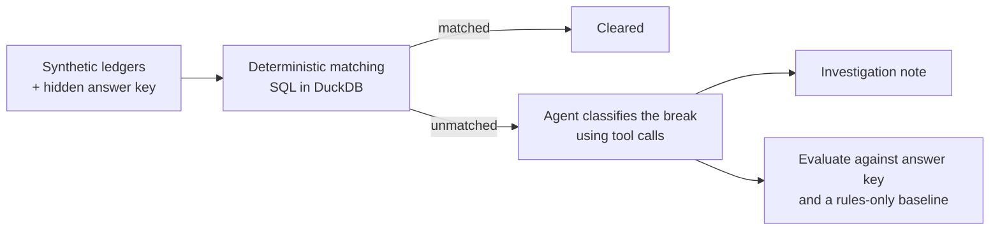

# Reconciliation Break Triage Agent

Python · DuckDB · OpenAI API (tool calling) · FastAPI

A bank statement and a company's general ledger (GL) should agree. Where they don't, each difference is a **break** that an analyst must explain before the books can close. This project clears the easy matches with SQL and hands every leftover item to an LLM agent. The agent works out which of six break types the item is and writes a short investigation note. The agent is scored against a planted answer key and against a rules-only baseline.

## Problem

In a month-end or quarter-end close, bank reconciliation is a record-to-report (R2R) task. Most transactions match mechanically, but the remainder, such as cheques not yet cleared, FX differences, short payments, double postings, typos and unrecorded bank charges, each needs someone to open both ledgers, compare amounts and dates, and decide what happened. That investigation is repetitive and rule-like, but not quite rule-simple, which is why it's a reasonable job for an agent with good tools.

## Architecture



**Design rule: the LLM never does arithmetic.** SQL does all the matching. Six Python tools do every calculation: differences, percentages, the divisible-by-9 check and FX re-conversion. The model only chooses which tools to call, picks a label, and writes a note in which every number must come from a tool result. Code checks that: any note citing a number no tool returned is flagged as **ungrounded**.

| Step | File | What it does |
|---|---|---|
| Data | `src/generate_data.py` | 5,000 seeded transactions in both ledgers with realistic noise; plants 400 breaks and records them in `data/answer_key.csv` |
| Matching | `sql/match.sql`, `src/match.py` | Three SQL passes in DuckDB; checks that every row is accounted for exactly once |
| Baseline | `src/rules_baseline.py` | If-then rules a finance team might build in Excel |
| Tools | `src/tools.py` | The six functions the agent may call; none can read the answer key |
| Agent | `src/agent.py` | OpenAI tool-calling loop (no LangChain), capped at 6 tool calls, temperature 0 |
| Evaluation | `src/evaluate.py` | The only file that reads the answer key; scores both methods on the same held-out test set |
| API | `src/api.py` | FastAPI service: `/health`, `/exceptions`, `/triage` |

## Break taxonomy

| Break type | What happened | How it shows up |
|---|---|---|
| Timing | Recorded in the GL, not yet through the bank (outstanding cheque, deposit in transit) | GL only |
| FX difference | Foreign-currency item converted at two different rates | Same reference, amounts differ, full foreign amount settled |
| Partial payment | Only part of the amount was paid | Same reference, bank amount smaller, not explained by the rate |
| Duplicate | The same entry posted twice in the GL | Two GL rows, one bank row |
| Transposition | Two digits swapped when keying (45,120 → 45,210) | Difference divisible by 9, same digits |
| Missing entry | The bank did something the GL never recorded (charges, interest, direct debits) | Bank only |

## Data

The data is **synthetic**: no real bank or company data is used. Real statements and GLs are confidential and come with no answer key. `generate_data.py` (seed 42) creates 5,000 transactions over July to September 2026, 15% of them in USD, and writes each into both ledgers with realistic noise. Bank dates lag by 0 to 3 days, bank descriptions are upper-cased and truncated, and 20% of bank rows lack a reference. It then plants 400 breaks, about 65 of each type, and 118 of those are deliberately hard:

- partial payments of 95-99%, some in USD, that look like FX differences
- FX differences over 2%, invoiced before a sharp rupee move on 14 August
- timing items from mid-month rather than month-end
- duplicates keyed a second time with a slightly different reference
- missing entries with vague bank text (no CHG, FEE or INT)

Nothing in an ID, description or column hints at the break type, and every run produces identical files.

## Results

SQL matching cleared **94.04%** of the 10,064 ledger rows. The 400 remaining exceptions each trace to exactly one planted break. 50 exceptions were set aside at random as a **dev set** for prompt tuning. The other **350 form the test set**, which the agent runs on once, and only the test set is reported.

<!-- RESULTS:START -->
Scored on the test set, 350 held-out exceptions · seed 42 · model gpt-4.1-mini · 2026-09-25

| Break type | n | Rules baseline | Agent |
|---|---|---|---|
| timing | 61 | 68.9% | 100.0% |
| fx_difference | 57 | 75.4% | 96.5% |
| partial_payment | 54 | 92.6% | 100.0% |
| duplicate | 57 | 64.9% | 70.2% |
| transposition | 61 | 100.0% | 98.4% |
| missing_entry | 60 | 58.3% | 100.0% |
| **Overall** | **350** | **76.6%** | **94.3%** |
| Hard cases only | 105 | 21.9% | 84.8% |
| Labelled unclear | | 22.0% | 0.0% |

- **Lift:** +17.7 percentage points (agent minus rules)
- **Ungrounded notes:** 0 of 350 (a note citing a number no tool returned)
- **Cost:** $0.78 estimated, $0.0022 per exception, 3.3 tool calls on average
- **Auto-match rate:** 94.04% of all ledger rows cleared by SQL before any exception reached the agent (5,000 synthetic transactions)
<!-- RESULTS:END -->

`unclear` counts as wrong. Full report with confusion matrices: `results/report_test.md`.

## What went wrong

The agent got 20 of the 350 test items wrong, and 17 of them are duplicates. On duplicates it scored 70.2%, barely ahead of the rules at 64.9%.

- **Re-keyed duplicates.** When the second copy of an entry was keyed with a slightly different reference, the agent's own search found the bank payment for the identical amount and counterparty under a reference one swap away, already matched to another GL row. It did not take the last step, that the other GL row is the twin, and called the item timing, or even missing_entry, which the taxonomy rules out for a GL-only item.
- **The other three errors.** Two FX differences were called partial payments despite an implied rate close to market; one of those notes misread the sign of an outgoing payment. One transposition was also called a partial payment.

In every error I checked, the tools had returned the right evidence and no note cited an invented number, so all the mistakes are reasoning, not data. The next step would be a tool that looks for same-amount, same-counterparty twins in the GL directly. It was not added, because changing the system after seeing the test results would invalidate the test score.

Tuning on the dev set also turned up a real bug: the FX tool first measured the "rate effect" in a way that made a typo in the rupee amount look like an exchange-rate difference. Details and the full error analysis are in `LOG.md`.

## Limitations

- **Synthetic data.** Planted breaks are cleaner than real ones. Real breaks combine types, and real descriptions are messier. The accuracy shows the method works; it is not a claim about any real company's books. On real data there is no answer key, so accuracy would be measured by an accountant reviewing a random sample of classifications.
- **The tools do much of the work.** While testing the loop offline, a scripted stand-in that followed the same investigation steps as fixed code also classified these synthetic breaks almost perfectly. Much of the lift over the baseline therefore comes from the tools (the implied-rate check and the same-reference and same-amount lookups). The agent's real advantage, handling cases no rule anticipated, needs real data to demonstrate.
- **Confidence is not informative.** The agent said "high" on 348 of 350 answers, right or wrong, so its stated confidence cannot decide which items go to a human. A real deployment would need another signal, such as disagreement between two runs or with the rules.
- One currency pair (USD/INR), one bank account, one quarter.
- No user has tested it, so no claim is made about analyst time saved.

## How to run

You need [uv](https://docs.astral.sh/uv/) and, for the agent, an OpenAI API key. Run everything from the project folder.

```bash
uv sync                                    # install Python libraries into .venv
uv run python -m src.generate_data         # 1. synthetic ledgers + answer key
uv run python -m src.match                 # 2. SQL matching -> exceptions
uv run python -m src.rules_baseline        # 3. rules-only baseline

# 4. the agent: copy .env.example to .env and put your key in it first
uv run python -m src.agent --one EXC-0027  # one exception, every step printed
uv run python -m src.agent --split dev     # 50 dev items; tune the prompt on these
uv run python -m src.evaluate --split dev --errors 10
uv run python -m src.agent --split test    # the test set, run once

# 5. score everything
uv run python -m src.evaluate --errors 10 --log --readme

# 6. the API (leave running), then open http://127.0.0.1:8000/docs
uv run uvicorn src.api:app --reload
```

Steps 1 to 3 need no API key and reproduce the committed data exactly. For Postman, import `postman/recon-triage.postman_collection.json`.
